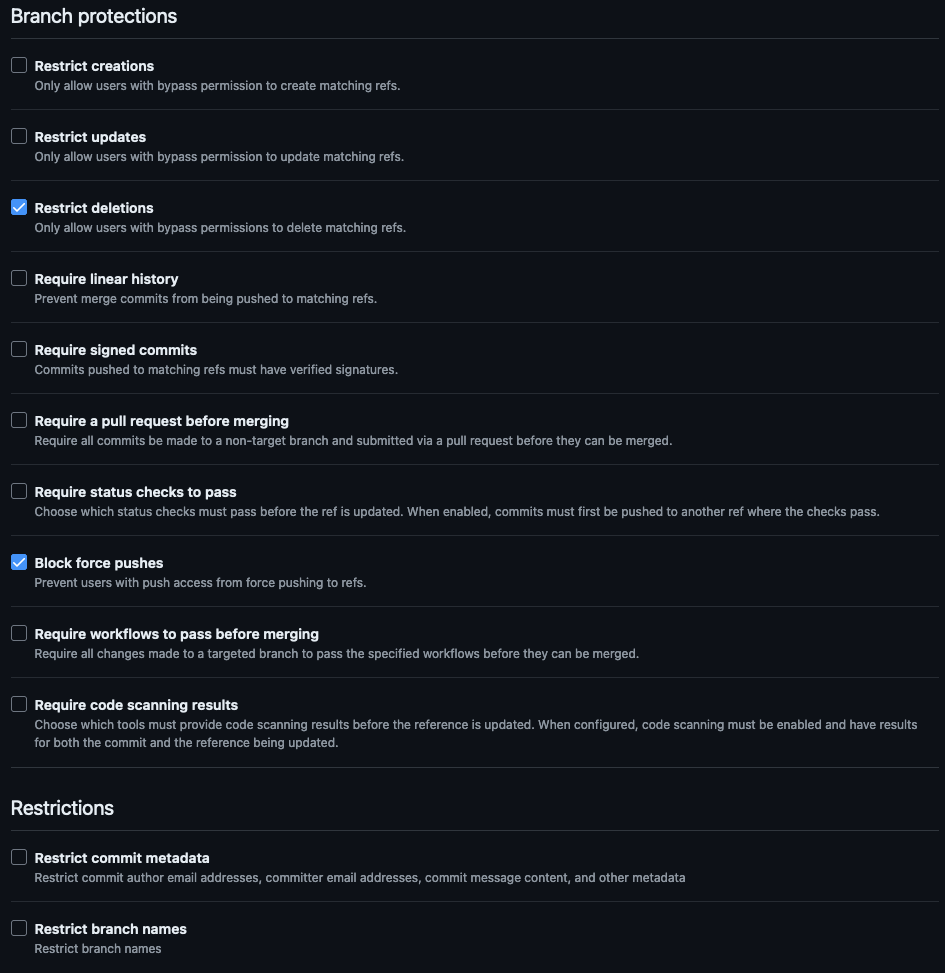
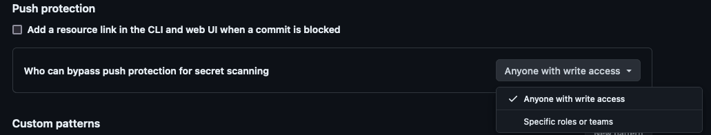

<!-- markdownlint-disable MD013 -->

## Scenario overview

Adopting GitHub's general platform best practices is crucial for effectively managing software development projects. These practices provide a structured framework that ensures projects are secure, maintainable, and scalable. By fostering a collaborative and efficient environment, these guidelines help organizations avoid common pitfalls, maintain high-quality codebases, and streamline project workflows. Ultimately, adhering to these best practices leads to successful and sustainable software projects.

Recent supply chain attacks, such as the [Shai-Hulud npm worm](/library/application-security/recommendations/managing-dependency-threats), "pwn requests" in GitHub Actions, and large-scale secret harvesting, targeted long-lived credentials, over-permissive automation, and unreviewed dependencies. The guardrails in this article reduce those risks.

For enterprise governance architecture decisions — including structural components, user access models, organization strategies, enterprise policies, billing, repository governance, teams and roles, programmatic access, and audit logs — use the companion guide [Essentials of governance and administration with GitHub Enterprise](./governance-administration-essentials).
This article remains focused on high-impact policy guardrails.

For additional topic-specific guidance, see also:

- [Repository rulesets best practices](./managing-repositories-at-scale/rulesets-best-practices)
- [Custom properties best practices](./managing-repositories-at-scale/custom-properties-best-practices)

## Do these first

Start with this baseline. Apply each control at the highest scope available (enterprise, then organization, then repository), pilot before you enforce, and verify coverage. These guardrails help teams adopt new capabilities, including AI agents, quickly and safely. All baseline controls are generally available; features labeled preview are not.

This baseline targets GitHub Enterprise Cloud. Some controls, such as Enterprise Managed Users and Copilot cloud agent settings, aren't available on GitHub Enterprise Server. On GitHub Enterprise Server, apply the controls your version supports, and use the server hardening and audit log streaming items in the checklist below.

- **[Centralize identity](./governance-administration-essentials):** SAML SSO or Enterprise Managed Users with automated deprovisioning, plus secure two-factor authentication (2FA).
- **Stop secret leaks:** push protection with delegated bypass on every repository, [Public Monitoring](https://github.blog/changelog/2026-10-28-public-monitoring-for-enterprises-generally-available/), and [rotation of exposed secrets](https://docs.github.com/enterprise-cloud@latest/code-security/tutorials/remediate-leaked-secrets/remediating-a-leaked-secret).
- **[Eliminate long-lived credentials](https://docs.github.com/enterprise-cloud@latest/admin/enforcing-policies/enforcing-policies-for-your-enterprise/enforcing-policies-for-personal-access-tokens-in-your-enterprise):** restrict classic personal access tokens (PATs), approve fine-grained PATs and GitHub App installations, and prefer GitHub Apps and OIDC.
- **[Limit exposure](https://docs.github.com/enterprise-cloud@latest/admin/enforcing-policies/enforcing-policies-for-your-enterprise/enforcing-repository-management-policies-in-your-enterprise):** block public repositories, visibility changes, forking of private and internal repositories, and outside collaborator invitations by non-owners.
- **[Protect default branches with rulesets](./managing-repositories-at-scale/rulesets-best-practices):** pull requests, CODEOWNERS review, required checks, and audited bypass.
- **[Apply least privilege to GitHub Actions](/library/application-security/recommendations/actions-security):** read-only `GITHUB_TOKEN`, approved actions pinned by SHA or [workflow lockfile](https://github.blog/changelog/2026-10-28-github-actions-workflow-lockfiles-are-generally-available/), and [workflow execution protections](https://github.blog/changelog/2026-09-17-workflow-execution-protections-in-github-actions-generally-available/) with `pull_request_target` disabled on public repositories.
- **[Enforce security configurations](/library/application-security/recommendations/enforce-ghas-at-scale):** secret scanning, push protection, Dependabot, and CodeQL on every eligible repository, [enforced for owners](https://github.blog/changelog/2026-09-15-enforce-github-advanced-security-configurations/).
- **[Govern Copilot and agents](./governing-agents):** the Copilot cloud agent firewall, managed permissions for agent operations, and an enterprise MCP allowlist.
- **[Govern dependencies](/library/application-security/recommendations/managing-dependency-threats):** route installs through a governed proxy or mirror, not directly from public registries.
- **[Monitor centrally](./governance-administration-essentials):** stream the audit log to your SIEM, and alert on policy changes and bypasses.

## Key design strategies and checklist

Use these key strategies as a baseline to implement GitHub's best practices for governance:

1. [Restrict Actions execution to specific repositories](https://docs.github.com/enterprise-cloud@latest/organizations/managing-organization-settings/disabling-or-limiting-github-actions-for-your-organization#managing-github-actions-permissions-for-your-organization) and not let repo users and owners to arbitrarily create and execute actions workflow. Set this at the **Organization level**.

2. **Allow only GitHub-authored actions and individually approved actions and reusable workflows** with the [allowed actions and reusable workflows policy](https://docs.github.com/enterprise-cloud@latest/admin/enforcing-policies/enforcing-policies-for-your-enterprise/enforcing-policies-for-github-actions-in-your-enterprise#allowing-select-actions-and-reusable-workflows-to-run), rather than all actions from Verified Creators. This setting can be enforced at the **Enterprise level**.

3. Default workflow token permission should be **read-only**: Following the principle of least privilege, [set the default `GITHUB_TOKEN` permissions](https://docs.github.com/enterprise-cloud@latest/admin/enforcing-policies/enforcing-policies-for-your-enterprise/enforcing-policies-for-github-actions-in-your-enterprise#workflow-permissions) to read-only explicitly. Enterprises and organizations created since February 2, 2023 default to read-only, but older ones default to read/write. If a read/write token is compromised, malicious actors can run exploits within the GitHub platform through actions execution.

4. Keep **Allow GitHub Actions to create and approve pull requests** disabled (the default). If enabled, workflows can approve pull requests, which might let attackers bypass code reviews and merge pull requests unintentionally. This can be set at either the **Enterprise** or **Organizational** level.

5. For other GitHub Actions controls, such as SHA pinning, lockfiles, and workflow execution protections, see [Securing GitHub Actions Workflows](/library/application-security/recommendations/actions-security).

6. **Disable forking** if not absolutely needed: You can help prevent sensitive information from being exposed by [disabling the ability to fork](https://docs.github.com/enterprise-cloud@latest/admin/enforcing-policies/enforcing-policies-for-your-enterprise/enforcing-repository-management-policies-in-your-enterprise#enforcing-a-policy-for-forking-private-or-internal-repositories) private and internal repositories.

7. **Disable changing repository visibility**: You should restrict who has the ability to [change the visibility](https://docs.github.com/enterprise-cloud@latest/admin/enforcing-policies/enforcing-policies-for-your-enterprise/enforcing-repository-management-policies-in-your-enterprise#enforcing-a-policy-for-changes-to-repository-visibility) of repositories, such as changing a repository from private to public, and who can [delete or transfer](https://docs.github.com/enterprise-cloud@latest/admin/enforcing-policies/enforcing-policies-for-your-enterprise/enforcing-repository-management-policies-in-your-enterprise#enforcing-a-policy-for-repository-deletion-and-transfer) them. Limiting these actions to owners helps prevent sensitive information from being exposed.

8. [Require two-factor authentication](https://docs.github.com/enterprise-cloud@latest/admin/enforcing-policies/enforcing-policies-for-your-enterprise/enforcing-policies-for-security-settings-in-your-enterprise#requiring-two-factor-authentication-for-organizations-in-your-enterprise) and enable [**Only allow secure two-factor methods**](https://docs.github.com/enterprise-cloud@latest/admin/enforcing-policies/enforcing-policies-for-your-enterprise/enforcing-policies-for-security-settings-in-your-enterprise#requiring-secure-methods-of-two-factor-authentication-for-organizations-in-your-enterprise) (passkeys, security keys, authenticator apps, and GitHub Mobile). Non-compliant members lose access, so communicate first. With Enterprise Managed Users, enforce MFA in your identity provider.

9. **Minimize privileged roles**: Keep [enterprise owners](https://docs.github.com/enterprise-cloud@latest/admin/managing-accounts-and-repositories/managing-roles-in-your-enterprise/abilities-of-roles), [organization owners](https://docs.github.com/enterprise-cloud@latest/organizations/managing-peoples-access-to-your-organization-with-roles/roles-in-an-organization), and [security managers](https://docs.github.com/enterprise-cloud@latest/organizations/managing-peoples-access-to-your-organization-with-roles/managing-security-managers-in-your-organization) to a minimum, and use just-in-time elevation to track and control owner access.

10. Implement **approval flow for fine grained personal access tokens**. If enabled at the Enterprise or Organization level, all organization members must request to get approval for their fine-grained personal access tokens that access any organization in your enterprise. This will help in reviewing which users are accessing what resources and with permissions on the PAT.

11. Enterprise owners should create a policy to **prevent org members from inviting outside collaborators**. Default is “No Policy”. Recommended is Enterprise owners or Organization Owners, so that there is centralized control on who can [invite and vet outside collaborators](https://docs.github.com/enterprise-cloud@latest/admin/enforcing-policies/enforcing-policies-for-your-enterprise/enforcing-repository-management-policies-in-your-enterprise#enforcing-a-policy-for-inviting-outside-collaborators-to-repositories).

12. Set up an Enterprise policy which [**prevents users and members from creating public repositories**](https://docs.github.com/enterprise-cloud@latest/admin/enforcing-policies/enforcing-policies-for-your-enterprise/enforcing-repository-management-policies-in-your-enterprise#enforcing-a-policy-for-repository-creation). Also restrict public [GitHub Pages sites](https://docs.github.com/enterprise-cloud@latest/organizations/managing-organization-settings/managing-the-publication-of-github-pages-sites-for-your-organization), public [packages](https://docs.github.com/enterprise-cloud@latest/packages/learn-github-packages/configuring-a-packages-access-control-and-visibility), and public [Codespaces port forwarding](https://docs.github.com/enterprise-cloud@latest/codespaces/managing-codespaces-for-your-organization/restricting-the-visibility-of-forwarded-ports).

13. **Restrict [deploy keys](https://docs.github.com/enterprise-cloud@latest/admin/enforcing-policies/enforcing-policies-for-your-enterprise/enforcing-repository-management-policies-in-your-enterprise#enforcing-a-policy-for-deploy-keys)** and use GitHub Apps instead. Disabling deploy keys also disables existing keys, so inventory them first.

14. **Webhooks should always be configured with a secret**. Not using a secret in the webhook will mislead the receiving entity of the webhook on the authenticity of the payload received.

15. Webhooks should be configured to [**use TLS**](https://docs.github.com/enterprise-cloud@latest/webhooks/using-webhooks/best-practices-for-using-webhooks#use-https-and-ssl-verification).

16. Always use **Repository Rulesets**, including [enterprise rulesets](https://docs.github.com/enterprise-cloud@latest/admin/enforcing-policies/enforcing-policies-for-your-enterprise/managing-policies-for-code-governance) on default and release branches. [Require](https://docs.github.com/enterprise-cloud@latest/repositories/configuring-branches-and-merges-in-your-repository/managing-rulesets/available-rules-for-rulesets) pull requests with **CODEOWNERS** approval, **dismiss stale approvals** on new pushes, require status checks (including code scanning), and block force pushes and deletion. Target rulesets with [custom properties](https://docs.github.com/enterprise-cloud@latest/organizations/managing-organization-settings/managing-custom-properties-for-repositories-in-your-organization) such as owner and criticality.
    

17. **Define CODEOWNERS**: To protect a repository against unauthorized changes, you also need to define owners using a `CODEOWNERS` file. The most secure method is to define a `CODEOWNERS` file in the `.github` directory of the repository and define the repository owner as the owner of either the `CODEOWNERS` file (`/.github/CODEOWNERS @owner_username`) or the whole directory (`/.github/ @owner_username`).

18. Initiate and impose **commit signing** whenever possible. This will deter malicious actors from creating a commit with malicious code and help prevent a possible supply chain attack.

    > **Note:** Copilot cloud agent signs its commits automatically. For broader agent governance guidance, see [Governing agents in GitHub Enterprise](./governing-agents)

19. **Keep ruleset bypass lists minimal, audited, and for emergencies only.** Every actor who can bypass a ruleset is a path for an attacker to compromise the integrity of the codebase, so review bypass lists regularly and alert on bypass events.

20. **Runner groups should be limited** to a select number of repositories. Configuring a runner group for all repositories can expose vulnerabilities or allow malicious actors to exploit misconfigured runners. Additionally, maintaining runner groups for specific repositories ensures that self-hosted runners are used for their intended specialized workloads. Granting access to everyone in the organization can lead to wasting resources on unnecessary execution tasks.

21. **Bypass Push Protection:** By default, anyone with write access can bypass a commit blockage due to push protection. Considering the criticality of leaked secrets, it is recommended to use [delegated bypass](https://docs.github.com/enterprise-cloud@latest/code-security/concepts/secret-security/delegated-bypass) to limit bypass capability to specific roles and teams.
    

22. **[Harden GitHub Enterprise Server](https://docs.github.com/enterprise-server@latest/admin/configuring-settings/hardening-security-for-your-enterprise)**: run a supported, patched release, enable private mode, keep [anonymous Git read access](https://docs.github.com/enterprise-server@latest/admin/enforcing-policies/enforcing-policies-for-your-enterprise/enforcing-repository-management-policies-in-your-enterprise#configuring-anonymous-git-read-access) disabled, restrict network access, and test backup and restore.

23. For public and open source repositories, run GitHub Security Lab's [gh-secure](https://github.com/GitHubSecurityLab/gh-secure) CLI extension to turn on recommended security features in one pass.

24. **Audit log streaming** is often overlooked by enterprises when implementing GitHub. Streaming audit logs from GitHub is crucial for monitoring platform usage trends. The extensive data captured in these logs provides valuable insights into potential unwanted activities occurring on the platform. For setup, see [Essentials of governance and administration](./governance-administration-essentials).

25. [**Alert on high-risk events**](https://docs.github.com/enterprise-cloud@latest/admin/monitoring-activity-in-your-enterprise/reviewing-audit-logs-for-your-enterprise/audit-log-events-for-your-enterprise): ruleset and push protection bypasses, policy or visibility changes, and new tokens, apps, or deploy keys.

## Roll out safely and respond to incidents

Many of these policies revoke access or block existing workflows. Inventory the affected users, tokens, deploy keys, and integrations, including the [enterprise credential inventory](https://docs.github.com/enterprise-cloud@latest/admin/managing-iam/respond-to-incidents/reviewing-credentials-in-your-enterprise); pilot with a small group, using evaluate mode where available; then enforce, and monitor every exception.

In an incident, [revoke credentials by token type](https://github.blog/changelog/2026-08-18-credential-revocation-and-deauthorization-by-token-type/) and rotate affected secrets. Use GitHub's guides to [prepare for](https://docs.github.com/enterprise-cloud@latest/code-security/tutorials/secure-your-organization/prepare-for-a-security-incident) and [respond to](https://docs.github.com/enterprise-cloud@latest/code-security/tutorials/secure-your-organization/respond-to-a-security-incident) a security incident.

## Seeking further assistance

{}

## Related links

{}
